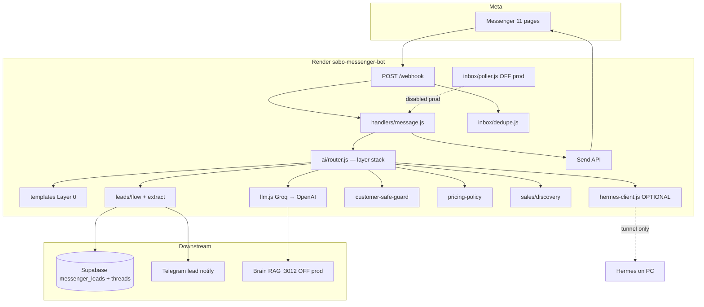

# SABO Messenger Bot — Agent Handoff (SSoT)

> **Agent tiếp quản đọc file này TRƯỚC.** Chi tiết đầy đủ: [MESSENGER_BOT_REFERENCE.md](./MESSENGER_BOT_REFERENCE.md).  
> Repo: `D:\0.PROJECTS\messenger-bot` · Git: `longsangsabo2025/sabo-messenger-bot` · Branch: `main`

---

## Purpose & prod URL

| Item | Value |
|------|-------|
| **Là gì** | Webhook server trả lời **Facebook Messenger inbox** cho **11 page SABO** — persona **Uyển Nhi**, thu lead, notify sales |
| **Business** | Lead gen pipeline **SABO M&T** (revenue engine #1) — qualify → `messenger_leads` (Supabase) → Telegram admin |
| **Production URL** | https://sabo-messenger-bot.onrender.com |
| **Health** | https://sabo-messenger-bot.onrender.com/health |
| **Webhook** | `https://sabo-messenger-bot.onrender.com/webhook` |
| **Render service** | `sabo-messenger-bot` · ID `srv-d8psv69194ac739luu00` · Singapore free tier |
| **Meta Live app** | `683588114593911` (webhook subscription) |
| **11 pages** | 5 SABO M&T (T0) + 5 project (T1) + 1 CEO handoff Billiards VT (T2) — map trong `src/pages.js` |

**KHÔNG thuộc scope:** Travis `:8300`, EVA panel, Admin dashboard, `social_facebook` worker (outbound only).

---

## Architecture (webhook → layers → Groq/OpenAI)

**Prod mặc định:** Groq/OpenAI trực tiếp trên Render. **Hermes chỉ khi** `HERMES_ENABLED=true` + URL reachable (tunnel PC → Render) — không phụ thuộc Hermes để chạy 24/7.



### Router layer order (`src/ai/router.js`)

1. `customer-safe-input-blocked` — prompt injection / exfil
2. `hydrateThread` + FB profile (`facebook/profile.js`)
3. `phone-recall` / `phone-denial` / `frustration-recovery`
4. **`pricing-handoff`** — hỏi giá → không VND, xin Zalo/SĐT
5. `sales-scope` / `greeting-intro` / `sales-discovery`
6. Layer 0 `templates.js` (skip sau lượt đầu trên sabo-mt/rag-mini)
7. **Hermes** (nếu enabled + healthy) → failover `customer-safe-hermes-policy`
8. **Groq** `llama-3.3-70b-versatile` → **OpenAI** `gpt-4o-mini`
9. Output guard `customer-safe-guard.js` — scrub VND/path/keys
10. Async `leads/queue.js` → Supabase + Telegram

---

## Current prod commit (verify)

```bash
curl -s https://sabo-messenger-bot.onrender.com/health
# → gitCommit phải khớp commit trên main sau deploy
```

| Cách verify | Chi tiết |
|-------------|----------|
| `/health` field | `gitCommit` = SHA Render deploy (`RENDER_GIT_COMMIT`) |
| Local vs prod | `git rev-parse HEAD` trong `messenger-bot/` so với prod |
| Last known live | `30cb5ca` — pricing handoff, deploy `dep-d8qdj2e8bjmc738k5ceg` (2026-06-19 DEVLOG) |

Expect `/health`: `status: ok`, `pages: 11`, `tokensConfigured: 11`, `ai.llm: true`, `ai.leadQueue: true`, `ai.inboxPoller.enabled: false`, `ai.brainRag: false`.

---

## Env vars (no secrets — where keys live)

Bootstrap: `src/config/env-bootstrap.js` — đọc theo thứ tự `ENV_SOURCES` (`.env` local → monorepo paths → `D:\0.PROJECTS\.env.secrets`).

| Var | Purpose | Typical source |
|-----|---------|----------------|
| `GROQ_API_KEY` | Primary LLM prod | `.env.secrets`, `05-TOOLS/.env` |
| `GROQ_MODEL` | Default `llama-3.3-70b-versatile` | `.env` |
| `OPENAI_API_KEY` | LLM fallback | `00-MASTER-ADMIN/admin/.env`, travis `.env` |
| `VERIFY_TOKEN` | Webhook verify | `longsang_messenger_bot_2026` |
| `META_APP_ID` / `META_APP_SECRET` | Graph Live app | admin `.env` (`VITE_FACEBOOK_APP_ID`) |
| `META_USER_ACCESS_TOKEN` | Auto-fetch page tokens | `.env.secrets` |
| `PAGE_ACCESS_TOKEN_*` | 11 page Send API tokens | admin `.env` (mapped `ADMIN_TOKEN_BY_PAGE_ID`) |
| `SUPABASE_URL` + `SUPABASE_SERVICE_KEY` | Leads + threads | Shared **`diexsbzqwsbpilsymnfb` only** |
| `TELEGRAM_BOT_TOKEN` + `TELEGRAM_ADMIN_CHAT_ID` | Hot lead notify admin | admin `.env` — **không** phải `@lssystems_bot` |
| `RENDER_API_KEY` | `deploy:render` script | `D:\0.PROJECTS\.env.secrets` |
| `CUSTOMER_SAFE_MODE` | Default `true` | `.env.example` |
| `INBOX_POLLER_ENABLED` | Backup poll | **`false` prod** (tránh double-reply) |
| `BRAIN_RAG_ENABLED` / `BRAIN_RAG_URL` | RAG prefetch | Prod **off**; local `:3012` |
| `HERMES_ENABLED` / `HERMES_API_URL` / `HERMES_API_KEY` | Optional full agent | Local/tunnel only; prod **off** |
| `OLLAMA_*` | Local dev LLM | PC only |
| `MONOREPO_ROOT` | Bootstrap paths | `D:\0.PROJECTS` |
| `DATABASE_URL` | `npm run db:migrate` | Supabase connection string (migrate only) |

Page token env names: `PAGE_ACCESS_TOKEN_SABO_DESIGN`, `_SABO_WEB`, `_SABO_AGENCY`, `_SABO_APP`, `_SABO_HUB`, `_AI_ART_NEWBIE`, `_BDS_VUNGTAU`, `_APP_BILLIARDS`, `_AI_NEWBIE_VN`, `_SABO_MEDIA`, `_SABO_BILLIARDS`.

**Never commit:** `.env`, `.env.secrets`, tokens, full keys in docs.

---

## Operational rules

| Rule | Detail |
|------|--------|
| **24/7 on Render** | PC founder **tắt OK** — bot chạy cloud, không cần pm2 local |
| **Poller OFF prod** | `INBOX_POLLER_ENABLED=false` — webhook Live + `dedupe.js` đủ; bật poller chỉ khi Meta Dev mode hoặc webhook outage (ghi DEVLOG) |
| **Hermes optional** | Prod reply = Groq/OpenAI. Hermes cần tunnel (`scripts/setup-cloudflare-tunnel.ps1`) + PC online |
| **No Travis** | Không route reply qua Travis `:8300` |
| **Supabase instance** | Chỉ shared `diexsbzqwsbpilsymnfb` — không mix Arena/Hub DB |
| **Ports** | Không auto-start dev server / steal ports — xem `_SHARED/PORT_OWNERSHIP_FOR_AGENTS.md` |
| **Ship trail** | Mọi thay đổi code → append `DEVLOG.md` |

---

## Policies shipped (CEO 2026-06-18/19)

### Customer-safe (`CUSTOMER_SAFE_MODE=true`)

| Layer | File |
|-------|------|
| Input guard | `src/ai/customer-safe-guard.js` + `router.js` |
| Hermes metadata | `src/ai/hermes-client.js` — `channel=facebook_messenger`, `policy=customer_safe` |
| Output guard | Block path, env names, stack trace, internal hosts |
| Safe template | `buildCustomerSafeSalesReply()` |

Tests: `npm run test:customer-safe`, `test:customer-safe-e2e`

### Pricing handoff (no VND on chat)

| Layer | File |
|-------|------|
| Early layer | `src/sales/pricing-policy.js` — `isPricingQuestion`, `buildPricingHandoffReply` |
| Output guard | `customer-safe-guard.js` — block `\d tr`, `triệu`, `Gói Basic`, … |
| Catalog | `src/sales/sabo-mt-catalog.js` — `priceHint` agent-only |
| Prompts | `prompts.js`, `uyen-nhi-soul.js`, `flow.js` |

Tests: `npm run test:pricing-policy`

### Phone ground truth

| Rule | File |
|------|------|
| Không claim SĐT giả | `extract.js` — `hasVerifiedPhone`, `clearFalsePhone` |
| Post-qualify chỉ khi need + contact hợp lệ | `flow.js`, `post-qualify-consult.js` |
| Phone recall/denial layers | `router.js` |

### Sales discovery

| Rule | File |
|------|------|
| Intent discovery → 2–3 offer cụ thể, không essay MVP | `src/sales/discovery.js` |
| Router layer `sales-discovery` | `router.js` |

Tests: `npm run test:sales-discovery`, cases in `test:lead-flow`

### Conversation UX (global)

- Tự xưng **em**, gọi khách **anh/chị**; một field/lượt lead
- Tên từ FB Graph — không hỏi tên nếu đã có
- Hotline theo trang — bida (App Quản lý Giải Đấu Billiards, SABO Billiards Vũng Tàu) `0961 167 717`, các trang khác `0798893333` — **chỉ** khi khách hỏi rõ
- Không bảo khách "gọi điện" — team chủ động liên hệ sau SĐT/Zalo

Soul SSoT: `10-AI-BRAIN/hermes/shared/souls/uyen_nhi.md` → `src/personas/uyen-nhi-soul.js`

---

## Test gate (bắt buộc trước deploy)

```bash
cd D:\0.PROJECTS\messenger-bot
npm run test:predeploy
```

Chạy lần lượt: `test:customer-safe` → `test:customer-safe-e2e` → `test:lead-flow` → `test:conversation-regression` → `test:dedupe` → `test:sales-discovery` → `test:pricing-policy`.

**Exit 1 = không deploy.** `npm run deploy:render` và `scripts/deploy-render.cjs` cũng gate tự động.

Optional local replay: `npm run test:conversation-local`

---

## Deploy procedure

### 1. Test local

```bash
npm run test:predeploy
```

### 2. Commit + push `main`

```powershell
cd D:\0.PROJECTS\messenger-bot
git add -A
git commit -m "..."
# Windows SSL: dùng schannel, bỏ GITHUB_TOKEN stale
Remove-Item Env:GITHUB_TOKEN -ErrorAction SilentlyContinue
git -c http.sslBackend=schannel push origin main
```

Render **auto-deploy** on push nếu GitHub connected.

### 3. Hoặc deploy API trực tiếp

```powershell
# RENDER_API_KEY từ D:\0.PROJECTS\.env.secrets — clear stale shell var trước
Remove-Item Env:RENDER_API_KEY -ErrorAction SilentlyContinue
npm run deploy:render
```

Script: `scripts/deploy-render.cjs` — sync env vars + trigger deploy + wait `live`.

### 4. Post-deploy verify

```bash
curl -s https://sabo-messenger-bot.onrender.com/health
npm run e2e:meta -- --production
```

Chạy `GET /setup` một lần sau deploy đầu hoặc khi đổi menu/Get Started.

---

## Common failures

| Symptom | Cause | Fix |
|---------|-------|-----|
| Bot im lặng sau welcome | Webhook crash (historical bad `require` path) hoặc LLM down | Check Render logs `event_processing_failed`; verify `/health` llm true |
| **Duplicate reply** | Poller ON + webhook cùng message | Set `INBOX_POLLER_ENABLED=false` prod; dedupe via `src/inbox/dedupe.js` + migration `004` |
| **Groq 429** | Rate limit | Fallback OpenAI; hoặc rule-based ack khi cả chain fail (pending improvement) |
| **OpenAI 401** | Key missing/invalid trên Render | Sync env via `deploy:render` từ bootstrap local |
| Deploy missing file | Push chưa đủ file (e.g. `dedupe.js`) | `test:predeploy` + verify git trên main trước deploy |
| Hermes timeout | Tunnel PC off / wrong URL | `HERMES_ENABLED=false` prod; hoặc fix tunnel `HERMES_API_URL` |
| **Stale Supabase session** | Cold start + old `qualified` without phone | `hydrateThread` + `clearFalsePhone`; migration `003` threads |
| Send API fail | 24h messaging window hết | User phải nhắn lại page |
| `git push` SSL/auth fail | Windows cert / bad `GITHUB_TOKEN` | `http.sslBackend=schannel`, `Remove-Item Env:GITHUB_TOKEN`, `gh auth setup-git` |
| Render API deploy fail | Bad `RENDER_API_KEY` | Reload from `.env.secrets` |

---

## Key files map

| Area | Path |
|------|------|
| Entry | `src/index.js`, `src/webhook.js` |
| Message handler | `src/handlers/message.js`, `welcome.js` |
| **Router orchestration** | `src/ai/router.js` |
| LLM | `src/ai/llm.js` |
| Hermes (optional) | `src/ai/hermes-client.js` |
| **Pricing policy** | `src/sales/pricing-policy.js` |
| **Sales discovery** | `src/sales/discovery.js`, `sabo-mt-catalog.js` |
| **Customer-safe** | `src/ai/customer-safe-guard.js` |
| **Dedupe** | `src/inbox/dedupe.js`, `sql/004_messenger_processed_mids.sql` |
| Poller (backup) | `src/inbox/poller.js` |
| Lead flow | `src/leads/flow.js`, `extract.js`, `queue.js`, `post-qualify-consult.js` |
| Session | `src/session/store.js`, `persist.js` |
| Pages / contracts | `src/pages.js`, `src/strategies/page-contracts.js` |
| Prompts / persona | `src/responses/prompts.js`, `src/personas/uyen-nhi-soul.js` |
| Templates L0 | `src/ai/templates.js` |
| Env bootstrap | `src/config/env-bootstrap.js` |
| Deploy | `scripts/deploy-render.cjs`, `render.yaml` |
| Tests | `scripts/test-*.cjs`, `package.json` scripts |
| SQL | `sql/001`–`004` |

---

## CEO test checklist (live Messenger)

Test trên page **SABO Media & Technology** (hoặc SABO Web). Warm `/health` trước (cold start ~30–60s).

| # | Gửi tin | Expect |
|---|---------|--------|
| 1 | `Xin chào` | Chào Uyển Nhi + 1 câu qualify dịch vụ — **không** dump hotline |
| 2 | `Bên mình làm web giá bao nhiêu?` | **Không** số VND/gói; xin Zalo/SĐT để team gửi báo giá |
| 3 | `0961167717` | Ghi nhận SĐT; có thể hỏi thêm need — **không** claim đã có SĐT nếu chưa gửi |
| 4 | `Cho tôi biết SĐT của tôi` | Trả đúng ground truth (có/không) — không bịa |
| 5 | `Có dịch vụ công nghệ nào thú vị không?` | 2–3 gợi ý cụ thể (web lead, SABOHUB, automation) — không essay MVP |

Sau qualify: check Telegram notify + row `messenger_leads` `lead_status=qualified` trên Supabase shared.

---

## Pending / not done

| Item | Notes |
|------|-------|
| **Hermes tunnel prod** | `HERMES_ENABLED=false` on Render; cần Cloudflare tunnel + PC online để dùng full agent |
| **Official price list SSoT** | Bot handoff Zalo/SĐT — chưa wire catalog giá chính thức; tham chiếu business: `02-SABO-ECOSYSTEM/sabo-mt-website/SABO_MASTER_REFERENCE_v1.1.md`, `CHIEN_LUOC_PHAT_TRIEN_2026.md` |
| **LLM fail graceful ack** | Groq 429 + OpenAI 401 → có thể rơi `fallback-error`; cần rule-based "web thu lead" (DEVLOG 2026-06-18) |
| **Brain RAG on prod** | `BRAIN_RAG_ENABLED=false` — cần public URL Brain RAG nếu bật |
| **Telegram `@lssystems_bot`** | **Riêng** — Hermes fleet ops / SaboHub approval; **không** dùng cho messenger lead notify. Xem `10-AI-BRAIN/DEVLOG.md` |
| **Uyển Nhi omnichannel** | Telegram/Zalo adapters chưa ship — chỉ Messenger live |
| **REFERENCE.md poller section** | Stale "poller true prod" — ground truth = **OFF** (file này + `.env.example`) |

---

## Related docs

| Doc | Path |
|-----|------|
| **Canonical reference** | [MESSENGER_BOT_REFERENCE.md](./MESSENGER_BOT_REFERENCE.md) |
| Agent quick rules | [../AGENTS.md](../AGENTS.md) |
| README quick start | [../README.md](../README.md) |
| Env template | [../.env.example](../.env.example) |
| Changelog | [../DEVLOG.md](../DEVLOG.md) |
| Uyển Nhi soul | `10-AI-BRAIN/hermes/shared/souls/uyen_nhi.md` |
| Hermes profile setup | `scripts/setup-uyen-nhi-hermes-profile.ps1` |
| Brain RAG | `10-AI-BRAIN/travis/services/brain-rag/CLAUDE.md` |
| SABO pricing strategy | `02-SABO-ECOSYSTEM/sabo-mt-website/SABO_MASTER_REFERENCE_v1.1.md` |
| Brand / channels | `_SHARED/content/BRAND_CONTENT_MAP.md` |
| Port ownership | `_SHARED/PORT_OWNERSHIP_FOR_AGENTS.md` |
| Hermes Telegram ops | `10-AI-BRAIN/hermes/shared/TRAVIS_TELEGRAM_COMMANDS.md` |
| **@lssystems_bot alert hub** (send-only, không Messenger inbox) | [`_DOCS/LSSYSTEMS_BOT_HANDOFF_2026-06-19.md`](../../_DOCS/LSSYSTEMS_BOT_HANDOFF_2026-06-19.md) |

---

*Created: 2026-06-19 — single handoff SSoT for agent fleet takeover.*
