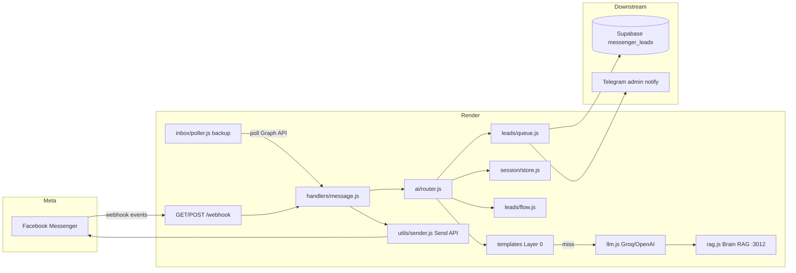

# SABO Messenger Bot — Canonical Reference

> **Agent đọc file này TRƯỚC** mọi task liên quan Messenger inbox, lead gen, Meta webhook, hoặc deploy Render.
>
> Repo: [longsangsabo2025/sabo-messenger-bot](https://github.com/longsangsabo2025/sabo-messenger-bot)  
> Workspace: `D:\0.PROJECTS\messenger-bot`

---

## 1. Purpose & business goal

### Là gì

**SABO Messenger Bot** = webhook server xử lý **Facebook Messenger inbox** cho **11 page SABO** — trả lời tự động, thu lead, notify sales. Đây là **feature quan trọng nhất** cho lead gen SABO M&T (theo CEO).

### Business goal

| Mục tiêu | Chi tiết |
|----------|----------|
| Lead gen | Qualify khách inbox → `messenger_leads` (Supabase) + Telegram notify → `sales_concierge` |
| Revenue engine | Nuôi pipeline **SABO Media & Technology** — chuyển đổi số, SABOHUB pilot, vertical templates |
| 11 pages | 5 page SABO M&T (T0) + 5 page project (T1) + 1 page handoff CEO (T2) |
| Persona | **Uyển Nhi** — trợ lý sales B2B, không robot tone |

### KHÔNG phải

- **Không** gọi Travis AI (`:8300`), Hermes gateway, hay `social_facebook` worker (outbound only)
- **Không** thay Admin dashboard hay EVA control plane
- **Không** commit secrets vào repo

### Uyển Nhi DNA (SSoT)

| Layer | Path |
|-------|------|
| Soul gốc (Hermes) | `10-AI-BRAIN/hermes/shared/souls/uyen_nhi.md` |
| Soul loader (omnichannel) | `src/personas/uyen-nhi-soul.js` |
| Hermes profile template | `hermes-profiles/uyen-nhi/` + `scripts/setup-uyen-nhi-hermes-profile.ps1` |
| Distilled runtime (LLM fallback) | `src/personas/uyen-nhi.js` |
| Page contracts | `src/strategies/page-contracts.js` |
| System prompts | `src/responses/prompts.js` |

Quy tắc voice: tự xưng **em**, gọi khách **anh/chị**; tiếng Việt tự nhiên; hỏi **một** field mỗi lượt; không nói "tôi là AI/chatbot".

### Uyển Nhi omnichannel (Messenger = adapter đầu tiên)

Messenger-bot **không** train persona riêng — chỉ gửi **channel context** + lead block; giọng Uyển Nhi từ soul SSoT.

| Thành phần | Chi tiết |
|------------|----------|
| Session key | `uyen-nhi:messenger:{vertical}:{pageId}:{psid}` — Telegram/Zalo dùng prefix `uyen-nhi:telegram:` / `uyen-nhi:zalo:` sau này |
| Hermes prompt | `getHermesChannelPrompt()` — soul file + messenger rules + vertical; **không** duplicate `getUyenNhiBlock()` |
| LLM fallback | `getSystemPrompt()` — giữ distilled block khi Hermes down |
| Profile Hermes | `pwsh scripts/setup-uyen-nhi-hermes-profile.ps1` → `~/.hermes/profiles/uyen-nhi/` (API khuyến nghị `:8643`) |
| Env | `HERMES_SOUL_PATH` (optional), `HERMES_ENABLED`, `HERMES_API_URL` |

---

## 2. Architecture



### Reply pipeline (3+ layers)

```
Inbound message
  → greeting-intro (Uyển Nhi, lần đầu / Get Started)
  → Layer 0: keyword template (giá/sản phẩm → thu lead; hotline chỉ khi hỏi rõ)
  → Layer 1: Groq llama-3.3-70b-versatile (fallback gpt-4o-mini)
  → Layer 1+: Brain RAG prefetch (optional, best-effort)
  → Fallback: greeting text cứng
  → Async: Supabase messenger_leads + Telegram
```

Entry points:

| File | Vai trò |
|------|---------|
| `src/index.js` | Express, `/health`, `/setup`, bootstrap env, start poller |
| `src/webhook.js` | Meta verify + POST events → `processEvent` |
| `src/handlers/message.js` | `generateReply` → `sendText` |
| `src/handlers/welcome.js` | Postback Get Started / ice breaker |
| `src/ai/router.js` | Orchestration chính |

---

## 3. Production URLs & IDs

> **Không chứa secrets.** Chỉ public IDs và URLs.

| Resource | Value |
|----------|-------|
| Production URL | https://sabo-messenger-bot.onrender.com |
| Health | https://sabo-messenger-bot.onrender.com/health |
| Webhook callback | `https://sabo-messenger-bot.onrender.com/webhook` |
| Render service ID | `srv-d8psv69194ac739luu00` |
| Render service name | `sabo-messenger-bot` |
| Render region | Singapore (free tier) |
| GitHub repo | `longsangsabo2025/sabo-messenger-bot` |
| Meta **Live** app (webhook) | `683588114593911` |
| Meta **ADMIN** app (legacy page tokens) | `1340824257525630` |
| Webhook verify token | `longsang_messenger_bot_2026` |
| Supabase instance (leads) | `diexsbzqwsbpilsymnfb` (shared) |

### Endpoints

| Method | Path | Mô tả |
|--------|------|--------|
| GET | `/health` | Status, AI config, poller stats, strategy counts |
| GET | `/webhook` | Facebook subscription verify (`hub.verify_token`) |
| POST | `/webhook` | Messenger `page` events (200 ngay, xử lý async) |
| GET | `/setup` | Get Started + Greeting + Persistent Menu (11 pages) |

---

## 4. AI stack

### LLM

| Priority | Provider | Model | Env |
|----------|----------|-------|-----|
| 1 | Groq | `llama-3.3-70b-versatile` | `GROQ_API_KEY`, `GROQ_MODEL` |
| 2 | OpenAI | `gpt-4o-mini` | `OPENAI_API_KEY`, `OPENAI_MODEL` |

Code: `src/ai/llm.js` — non-streaming, `max_tokens: 400`, `temperature: 0.5`, history trim 8 turns.

### Brain RAG

| Setting | Default prod | Local dev |
|---------|--------------|-----------|
| URL | `BRAIN_RAG_URL` (Render: thường không set → localhost unreachable) | `http://127.0.0.1:3012` |
| Enabled | `BRAIN_RAG_ENABLED=false` (`render.yaml`) | `true` trong `.env.example` |
| Endpoint | `POST /api/brain/rag/search` | Same |
| Timeout | `BRAIN_RAG_TIMEOUT_MS=5000` | |
| Limit | `BRAIN_RAG_LIMIT=4` | |

Code: `src/ai/rag.js` — **best-effort**; RAG fail không block reply.

**Bật RAG trên production:**

1. Brain RAG phải reachable từ Render (public URL hoặc tunnel — không mặc định)
2. Set Render env: `BRAIN_RAG_ENABLED=true`, `BRAIN_RAG_URL=https://<brain-rag-host>`
3. Redeploy; verify `/health` → `brainRag: true`

### Cost ballpark

~**$0.002/reply** (Groq llama-3.3-70b, ~400 tokens out, không RAG). OpenAI mini tương đương order of magnitude. Lead queue + Telegram = negligible.

---

## 5. Page strategies & contracts

### 11 pages (`src/pages.js`)

| Slug | Page name | projectSlug | Strategy | Tier |
|------|-----------|-------------|----------|------|
| SABO_DESIGN | SABO Design | sabo-mt | sabo-mt | t0 |
| SABO_WEB | SABO Web | sabo-mt | sabo-mt | t0 |
| SABO_AGENCY | SABO Agency | sabo-mt | sabo-mt | t0 |
| SABO_APP | SABO APP | sabo-mt | sabo-mt | t0 |
| SABO_MEDIA | SABO Media & Technology | sabo-mt | sabo-mt | t0 |
| SABO_HUB | SABO HUB | sabohub | rag-mini | t1 |
| AI_NEWBIE_VN | AI Newbie VN | ainewbie | rag-mini | t1 |
| AI_ART_NEWBIE | AI Art Newbie | ai-art | rag-mini | t1 |
| BDS_VUNGTAU | BĐS Vũng Tàu | vungtau | rag-mini | t1 |
| APP_BILLIARDS | App Billiards | sabo-arena | rag-mini | t0 |
| SABO_BILLIARDS | SABO Billiards VT | sabo-billiards | human-handoff | t2 |

### Strategy contracts

| Strategy | Pages | Behavior |
|----------|-------|----------|
| `sabo-mt` | 5 page SABO M&T | Sales prompt + optional RAG; persona Uyển Nhi |
| `rag-mini` | HUB, AI Newbie, AI Art, BĐS, Arena | Project prompt + Brain RAG tags (`page.ragTags`) |
| `human-handoff` | SABO Billiards VT | LLM ngắn + append hotline handoff; queue CEO |

### Page contracts (`src/strategies/page-contracts.js`)

Mỗi `projectSlug` có: `vertical`, `goal`, `persona` (`uyen_nhi` | `venue` | `generic`), `leadFields[]`, `greetingIntro`.

Lead fields: `name` | `contact` | `business_type` | `need` | `timeline` | `budget`

### Vertical segmentation (2026-06-18)

Bot **không** dùng một script chung — mỗi **vertical** (business lane) có tone, CTA, template Layer 0, và forbidden behaviors riêng.

| Vertical | Pages (`projectSlug`) | Persona | Goal | Lead fields | CTA |
|----------|----------------------|---------|------|-------------|-----|
| `billiards-ops` | `sabo-billiards`, `sabo-arena` | venue staff | đặt bàn / giải | need, contact | hỏi SĐT/Zalo — **không** dump hotline |
| `sabo-mt-services` | `sabo-mt` (5 page M&T) | Uyển Nhi B2B | qualify chuyển đổi số | need, contact, business_type, timeline, budget | qualify scope → xin SĐT/Zalo |
| `ai-education` | `ainewbie`, `ai-art` | Uyển Nhi teacher | học AI + soft upsell SABO | need, contact | trả lời ngắn → qualify → SĐT/Zalo |
| `real-estate` | `vungtau` | property advisor | nhu cầu BĐS | need, contact, timeline | khu vực + SĐT/Zalo |
| `platform` | `sabohub` | Uyển Nhi product | demo/trial SABOHUB | need, contact, business_type | use case → SĐT/Zalo demo |

**Code map:**

| File | Vai trò |
|------|---------|
| `src/strategies/page-contracts.js` | `VERTICALS`, `PAGE_CONTRACTS`, `buildVerticalPromptBlock()` |
| `src/responses/prompts.js` | `getSystemPrompt()` = Uyển Nhi/venue + vertical block + lead block |
| `src/ai/templates.js` | `VERTICAL_TEMPLATES` — keyword replies theo vertical |
| `src/ai/router.js` | Layer tag `strategy:verticalId`; billiards handoff **không** auto hotline |

**Forbidden (global):** không đưa hotline `0798893333` trừ khi khách hỏi rõ; không bảo "gọi điện" — team chủ động liên hệ sau khi có contact.

### Conversation UX — sales flow tự nhiên (CEO 2026-06-18, tham chiếu Highvision)

Bot phải hành xử như nhân viên sales VN thật, **không** interrogation robot.

**Flow chuẩn:**

1. Chào + giới thiệu dịch vụ + **một** câu qualify (loại/dịch vụ quan tâm)
2. Khách hỏi giá/ngân sách → làm rõ scope/loại trước, không lecture budget
3. Sẵn sàng báo giá → "Cho em xin SĐT (hoặc Zalo) để em gửi báo giá chi tiết nhé ạ"
4. Có SĐT → có thể hỏi Zalo để gửi file báo giá

**Facebook profile name (`src/facebook/profile.js`):**

- Lần đầu message: `GET /{psid}?fields=first_name,last_name,name` với page token
- Lưu `session.meta.profileName`, `firstName`, `honorific` (mặc định `anh/chị`)
- Auto-fill `lead.name` từ FB — **không** hỏi "tên là gì"
- Khách từ chối cho tên → `nameRefused: true`, chỉ xưng hô `anh/chị`

**Cấm tuyệt đối trong reply:**

- `em cần biết tên`, `cho em xin tên`, `không thể thấy tên user`
- Dump hotline `0798893333` khi chưa được hỏi
- Bảo khách "gọi điện" / "gọi hotline"

### Progressive lead collection (`src/leads/flow.js`)

1. Session profile per `(pageId, PSID)` + `session.meta` (FB profile) in `src/session/store.js`
2. `mergeLeadProfile` (`src/leads/extract.js`) parse SĐT/Zalo/email/need từ text; `refusesName()` detect từ chối
3. `buildLeadPromptBlock` inject vào system prompt — hỏi **một** field thiếu
4. **Complete** = có `need` + `contact` (name optional — từ FB hoặc bỏ qua nếu refused)
5. `queueLeadEvent` → `messenger_leads` + Telegram khi qualified / hot intent

### Session memory + post-qualify behavior (CEO bugfix 2026-06-18)

**Vấn đề đã fix:** Sau khi lead đủ (need + SĐT), bot hỏi lại tên/ngành — mất session.

| Layer | Hành vi |
|-------|---------|
| `store.js` | In-memory Map `(pageId, PSID)` → `messages`, `lead`, `meta`; TTL 24h |
| `persist.js` | Optional Supabase upsert `messenger_threads` (survive Render cold start) — cần migration `003_messenger_threads_lead_meta.sql` |
| `hydrateThread()` | Gọi đầu mỗi `generateReply` — load session từ DB nếu RAM trống |
| `qualified` flag | Set `true` khi `need` + `contact` đủ — kích hoạt **CHẾ ĐỘ TƯ VẤN SAU QUALIFY** |
| Post-qualify prompt | Cấm hỏi lại tên/SĐT/ngành; trả lời tư vấn ngắn + upsell nhẹ; nhắc team sẽ gọi theo SĐT đã lưu |
| Templates Layer 0 | Sau qualify: chỉ hotline/cảm ơn — intake templates (giá/sản phẩm) → LLM |
| `appendTurn` | Mọi reply path (template/fallback/LLM) ghi history để LLM nhớ context |
| FB profile | `ensureSessionProfile()` — Graph API `first_name,name` lần đầu; auto-fill `lead.name` |

**Retest CEO scenario:**
```bash
npm run test:lead-flow
# testSaboMtPostQualifyMultiTurn: website → nhi → 0961167717 → "tư vấn sơ" → KHÔNG hỏi tên/ngành
```

**Lead behavior (CEO policy 2026-06-18):**

| Rule | Chi tiết |
|------|----------|
| Thu lead chủ động | Qualify nhu cầu trước → xin SĐT/Zalo gửi báo giá |
| Tên khách | Lấy từ Facebook Graph API — không hỏi tên nếu đã có |
| SABO gọi khách | Không bảo khách "gọi hotline" hay "liên hệ qua SĐT công ty" |
| Hotline `0798893333` | Chỉ khi khách **hỏi rõ** hotline/số văn phòng, hoặc menu "Gọi ngay" |
| Layer 0 templates | `giá`/`ngân sách` → qualify scope; `sản phẩm` → list + qualify |
| Thứ tự thu | **need → contact** (một field/lượt); name từ FB, không bắt buộc hỏi |

### Key files map

```
src/facebook/profile.js         # Graph API PSID → profileName, honorific
src/pages.js                    # 11 page IDs, tokens, strategy, ragTags
src/strategies/page-contracts.js
src/personas/uyen-nhi.js
src/leads/flow.js
src/leads/extract.js
src/leads/queue.js
src/session/store.js
src/session/persist.js
src/responses/prompts.js
src/responses/greeting.js
```

---

## 6. Env vars & credential map

> **WHERE to find — never copy values into docs or commits.**

### Bootstrap order (`src/config/env-bootstrap.js`)

`ENV_SOURCES` (first wins for unset keys, except Supabase forced to shared ref):

| # | Path |
|---|------|
| 1 | `messenger-bot/.env` |
| 2 | `05-TOOLS/.env` |
| 3 | `05-TOOLS/fb-messenger-bot/.env` |
| 4 | `00-MASTER-ADMIN/admin/.env` |
| 5 | `02-SABO-ECOSYSTEM/sabo-mt-website/.env.local` |
| 6 | `02-SABO-ECOSYSTEM/sabo-mt-website/.env` |
| 7 | `10-AI-BRAIN/travis/services/travis-ai/.env` |
| 8 | `00-MASTER-ADMIN/admin/supabase/.env` |
| 9 | `01-MAIN-PRODUCTS/long-sang-ai/.env` |
| 10 | `D:\0.PROJECTS\.env.secrets` |

### Credential cheat sheet

| Var | Purpose | Typical source |
|-----|---------|----------------|
| `GROQ_API_KEY` | Primary LLM | `.env.secrets`, `05-TOOLS/.env` |
| `OPENAI_API_KEY` | LLM fallback | admin `.env`, travis `.env` |
| `VERIFY_TOKEN` | Webhook verify | Default `longsang_messenger_bot_2026` |
| `META_APP_ID` / `META_APP_SECRET` | Graph app webhook config | admin `.env` (`VITE_FACEBOOK_APP_ID`) |
| `META_USER_ACCESS_TOKEN` | Auto-fetch page tokens | `.env.secrets` |
| `PAGE_ACCESS_TOKEN_*` | 11 page Send API tokens | admin `.env` keys mapped in `ADMIN_TOKEN_BY_PAGE_ID` |
| `SUPABASE_URL` + `SUPABASE_SERVICE_KEY` | `messenger_leads` | Shared `diexsbzqwsbpilsymnfb` only |
| `TELEGRAM_BOT_TOKEN` + `TELEGRAM_ADMIN_CHAT_ID` | Hot lead notify | admin `.env` |
| `RENDER_API_KEY` | Deploy script | `.env.secrets` |
| `BRAIN_RAG_URL` / `BRAIN_RAG_ENABLED` | RAG context | Local `:3012`; prod off by default |
| `INBOX_POLLER_ENABLED` | Backup inbox poll | `true` prod (post hotfix 2026-06-18) |
| `MONOREPO_ROOT` | Bootstrap path | `D:\0.PROJECTS` |

### Page token env names

`PAGE_ACCESS_TOKEN_SABO_DESIGN`, `_SABO_WEB`, `_SABO_AGENCY`, `_SABO_APP`, `_SABO_HUB`, `_AI_ART_NEWBIE`, `_BDS_VUNGTAU`, `_APP_BILLIARDS`, `_AI_NEWBIE_VN`, `_SABO_MEDIA`, `_SABO_BILLIARDS`

---

## 7. Operations playbook

### Local dev

```bash
cd D:\0.PROJECTS\messenger-bot
npm install
cp .env.example .env
# Hoặc rely on env-bootstrap từ monorepo
npm start          # PORT default 3000
npm run dev        # watch mode
```

### Verify commands

```bash
# Health
curl http://localhost:3000/health
curl https://sabo-messenger-bot.onrender.com/health

# Webhook verify handshake
curl "http://localhost:3000/webhook?hub.mode=subscribe&hub.verify_token=longsang_messenger_bot_2026&hub.challenge=123"

# Automated tests
npm run test:replies      # 11 pages + 5 vertical scenarios
npm run test:lead-flow    # Lead extraction + vertical mapping + multi-turn
npm run test:lead         # Live lead queue (needs Supabase)
npm run db:migrate        # sql/001 + 002 + 003 on shared Supabase (needs DATABASE_URL)
```

### E2E Meta setup

```bash
npm run e2e:meta                    # local base URL
npm run e2e:meta -- --production    # production Render URL
```

Script `scripts/e2e-meta-setup.cjs`:

1. Configure app webhook → `CALLBACK_URL`
2. Subscribe 11 pages (`messages`, `messaging_postbacks`, …)
3. `GET /setup` — Get Started + menu
4. Simulate POST `/webhook`
5. Local `generateReply` smoke test

Override base: `MESSENGER_BASE_URL=https://...`

### Deploy Render

```bash
# RENDER_API_KEY from .env.secrets
npm run deploy:render
```

- Service ID: `srv-d8psv69194ac739luu00`
- Auto-deploy on push `main` (if connected)
- Post-deploy: `npm run e2e:meta -- --production`
- Manual: `GET https://sabo-messenger-bot.onrender.com/setup` once after first deploy

### Meta webhook setup (manual checklist)

1. Meta Developer → App **Live** `683588114593911`
2. Messenger → Webhooks → Callback URL = production `/webhook`
3. Verify token = `longsang_messenger_bot_2026`
4. Subscribe fields: `messages`, `messaging_postbacks`, `messaging_optins`, `message_deliveries`, `message_reads`
5. Subscribe **each** of 11 pages to app
6. Prefer `npm run e2e:meta -- --production` over manual clicks

### INBOX_POLLER — when to enable/disable

| Mode | Setting | When |
|------|---------|------|
| **Enabled** (default prod) | `INBOX_POLLER_ENABLED=true` | Production safety net; Meta dev mode (webhook chỉ tới app roles); Render cold-start miss |
| **Disabled** | `INBOX_POLLER_ENABLED=false` | Chỉ khi webhook Live 100% reliable **và** muốn giảm Graph API calls |

Poller: `src/inbox/poller.js` — interval default 45s (`INBOX_POLL_INTERVAL_MS`), dedup by `message.mid`, 24h lookback.

**Rule:** Không tắt poller trên prod trừ khi CEO/chủ đích — incident 2026-06-18: poller off + webhook bug = zero reply.

---

## 8. Troubleshooting (known issues)

### Dev mode webhook chỉ cho app roles

Meta **Development** app chỉ gửi webhook tới users có role trên app. Fix: dùng **Live** app `683588` hoặc bật **INBOX_POLLER**.

### Poller off + webhook fail = no reply (2026-06-18)

**Symptom:** Welcome/Get Started OK; follow-up text im lặng.  
**Root cause:** `src/webhook.js` lazy `require('../inbox/poller')` — **sai path** (đúng: `./inbox/poller`). Postback không chạm block `message.mid` → welcome OK; text message crash trước `handleMessage()`. Meta nhận HTTP 200 nhưng không gửi reply.  
**Fix:** Commit `23bf24c` — import đúng ở top file; default poller on.  
**Agent transcript:** [subagent a90d76c0](file:///C:/Users/admin/.cursor/projects/D-0-PROJECTS-10-AI-BRAIN/agent-transcripts/66c8259a-8bf9-4684-a25f-9d182ce5bbac/subagents/a90d76c0-3b4d-41b9-bfee-9f1a746e3ca9.jsonl)

### Render cold start

Free tier spin-down sau ~15 phút idle. Request đầu có thể mất 30–60s. Poller + webhook retry giúp; `/health` warm-up trước khi test.

### Page token `app_id` mismatch

Page tokens từ **ADMIN** app `1340824257525630` có thể khác **Live** app `683588114593911`. `subscribed_apps` có thể hiện app cũ trong khi webhook config trên Live app. Theo dõi Send API errors; migrate token sang Live app nếu cần.

### Send API 24h window

User phải nhắn trong 24h (hoặc dùng approved message tag). Hết window → Send API fail; log `utils/sender.js`.

### Supabase lead không ghi

- Check `/health` → `leadQueue: true`
- Migration `sql/002_messenger_leads.sql` đã chạy trên shared instance
- `env-bootstrap` phải resolve đúng `diexsbzqwsbpilsymnfb` (không lấy nhầm travis/hermes ref)

### Debug checklist

```bash
curl https://sabo-messenger-bot.onrender.com/health
# Expect: llm true, leadQueue true, inboxPoller.enabled true, tokensConfigured 11

npm run test:replies
npm run e2e:meta -- --production
```

Render logs: filter `event_processing_failed`, `message_received`, `message_sent`, `poller_reply`.

---

## 9. Agent rules

### Must do

1. **Đọc file này** trước khi sửa messenger-bot
2. **Scan code** — paths trong doc phải khớp `src/` thực tế
3. **Không commit** `.env`, tokens, `.env.secrets`
4. **Update `DEVLOG.md`** sau mọi ship (format ở cuối file)
5. **Verify** bằng `npm run test:replies` và/hoặc `test:lead-flow` khi đụng router/lead
6. **Foundation vs agent lane** (monorepo `10-AI-BRAIN`):
   - **Foundation lane:** shared contracts, Supabase schema, env-bootstrap — không đổi Uyển Nhi voice/persona trừ khi CEO yêu cầu
   - **Agent lane:** prompt, page-contracts, templates, greeting — OK trong `messenger-bot/`
   - Đừng sửa Travis/Hermes memory foundation để fix Messenger bug

### Must not

- Gọi Travis `:8300` cho reply path
- Hardcode API keys trong code hoặc docs
- Tắt `INBOX_POLLER` trên prod mà không ghi rõ lý do trong DEVLOG
- `pm2 start` / steal ports — Messenger chạy trên Render, local dev chỉ khi user yêu cầu
- Push force `main`

### Git & deploy

| Item | Value |
|------|-------|
| Remote | `https://github.com/longsangsabo2025/sabo-messenger-bot` |
| Branch | `main` |
| Deploy target | Render `sabo-messenger-bot` |

### Related monorepo docs

| Doc | Path |
|-----|------|
| Uyển Nhi soul | `10-AI-BRAIN/hermes/shared/souls/uyen_nhi.md` |
| Brain RAG | `10-AI-BRAIN/travis/services/brain-rag/CLAUDE.md` |
| Brand map | `_SHARED/content/BRAND_CONTENT_MAP.md` |
| Port ownership | `_SHARED/PORT_OWNERSHIP_FOR_AGENTS.md` |

---

## Appendix: SQL & schema

- `sql/001_messenger_threads.sql` — thread metadata (optional)
- `sql/002_messenger_leads.sql` — `messenger_leads` table

Lead row fields: `page_id`, `psid`, `project_slug`, `lead_status` (`new_lead` | `qualified`), `metadata` (name, need, …), `reply_layer`.

---

*Last updated: 2026-06-18 — canonical reference for agent fleet.*
